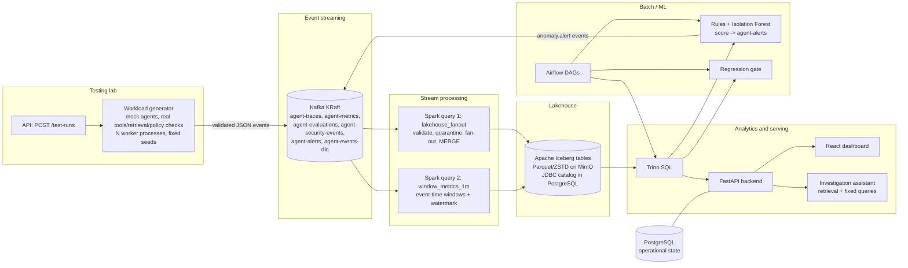

# AgentShield architecture

AgentShield tests, measures, monitors and secures AI agents. Synthetic, deterministic agent workloads emit
OpenTelemetry-style telemetry. The telemetry flows through a streaming lakehouse (Kafka, Spark, Iceberg/Parquet on
MinIO, Trino) and is analysed for performance, quality, anomalies and security. The same execution can therefore be
viewed from every angle, because all modules share one event contract.

## 1. Component diagram



Plain-text view of the main path:

```
generator --(Kafka, 6 topics)--> Spark Structured Streaming --(Iceberg commits)--> Parquet on MinIO
                                                                                  |
                       React UI <-- FastAPI (catalog queries only) <-- Trino SQL --+
detectors (rules + Isolation Forest) read Trino and publish alerts back to Kafka --> lakehouse
```

## 2. Components and pinned versions

| Layer | Technology (version) | Role in AgentShield |
|---|---|---|
| Workload generation | Python 3.12, Pydantic 2.10.6, confluent-kafka 2.8.0 | Mock agents (QA, RAG, tool-using, planner with delegation), fault injection, deterministic IDs |
| Telemetry schema | Pydantic models + contract tests | `generator/event_schema.py`: envelope + typed payloads, schema versions 1.0/1.1 |
| Event ingestion | Apache Kafka 3.9.0 (KRaft, 1 broker) | 6 topics, keyed by trace_id, lz4, idempotent producer, acks=all |
| Stream processing | Apache Spark 3.5.3 Structured Streaming (`local[4]`) | Validation/quarantine, fan-out, MERGE upserts, event-time windows |
| Table format | Apache Iceberg 1.7.1 (format v2), JDBC catalog | Snapshots, time travel, schema evolution, row-level MERGE/DELETE |
| Object storage | MinIO (bitnamilegacy/minio:2025.4.22) | S3-compatible storage for Parquet data and Iceberg metadata |
| SQL engine | Trino 467 (single node) | All analytics, summary tables, maintenance (optimize, expire_snapshots) |
| Operational DB | PostgreSQL 16 | Iceberg JDBC catalog, test-run requests, alert feedback, investigation log, Airflow metadata |
| Backend | FastAPI 0.115.8, SQLAlchemy 2.0.38, trino 0.333.0 | REST API, test-run orchestration, curated query catalog |
| ML | scikit-learn 1.6.1, SciPy | Isolation Forest, robust baselines, binomial window tests |
| Retrieval | scikit-learn TF-IDF (default); Sentence Transformers + FAISS optional | Investigation assistant knowledge retrieval |
| LLM (optional) | anthropic 1.13.0, model `claude-opus-5-5` | Rephrases evidence-grounded answers; optional groundedness judge |
| Orchestration | Apache Airflow 2.10.5 (LocalExecutor, optional profile) | lakehouse_maintenance, daily_agent_regression, anomaly_model_refresh |
| Frontend | React 18, Vite, TypeScript, Tailwind, Recharts, framer-motion, lucide-react | Landing page (`/`) + 12-page workbench (`/app/*`) served by nginx |
| Packaging | Docker Compose | Single-node local deployment with health checks and named volumes |

## 3. Event contract and topics

`generator/event_schema.py` is the single source of truth. Every event has an envelope:
`event_id, event_type, schema_version, event_time, producer, test_run_id, run_id, trace_id, agent_id,
agent_version, scenario_id, payload`.

| Event type | Topic | Payload highlights |
|---|---|---|
| `test_run.started` / `test_run.completed` | agent-traces | scenario, seed, workload mix, fault profile, totals |
| `span.completed` | agent-traces | span_id, parent_span_id, span_kind, timings, tokens, tool, policy decision, retrieval results |
| `run.metrics` | agent-metrics | outcome, latency, tokens, tools, retries, estimated cost, injected_faults (labels) |
| `worker.resource` | agent-metrics | generator worker CPU/memory/event rate |
| `evaluation.result` | agent-evaluations | evaluator, metric, score, passed, rubric, evidence, evaluator_type |
| `security.finding` | agent-security-events | rule, category, severity, action, detector, evidence |
| `anomaly.alert` | agent-alerts | detector, type, severity, score, window, related runs, explanation |

Identifiers: `test_run_id` = a benchmark run; `run_id` = one agent run (task execution); `trace_id` (32 hex) is
1:1 with run_id; `span_id` (16 hex). All IDs come from a per-task RNG seeded by (seed, task index), so the same
seed reproduces identical IDs regardless of worker count. Contract tests (`tests/unit/test_contracts.py`)
assert that the Spark parsing DDL and the Trino tables match the Pydantic models field for field.

The schema-evolution demonstration adds an optional field (`routing_strategy`, schema 1.1). The Spark writer
aligns every batch to the *current* Iceberg schema, so a column added with `ALTER TABLE` is populated for new
events, while old rows read it as NULL (sql/09).

## 4. Stream processing (streaming/spark_job.py)

**Query 1 - `lakehouse_fanout`** (foreachBatch, 10 s trigger, max 300,000 offsets per batch):

1. Parse the envelope with `from_json`; parse each payload type exactly once.
2. Structural validation. Records that fail are quarantined, with one of these reasons: malformed JSON, missing
   event_id, unknown event type, unparseable or missing timestamps, unsupported schema version, topic mismatch,
   missing required context fields, invalid payload.
3. Write *every* record to bronze `raw_agent_events` (with `is_valid` and `validation_error`). Copy invalid records
   to `dead_letter_events`. Nothing is silently dropped.
4. Fan valid records out to the curated facts (spans, run metrics, evaluations, findings, alerts, worker
   metrics). Derive features and attach row-level `dq_flags`.
5. Upsert `agent_test_runs` with an Iceberg `MERGE INTO` (latest lifecycle event per test run).
6. Append one row to `pipeline_batch_metrics` (rows, invalid rows, duration, ingest lag).

**Query 2 - `window_metrics_1m`**: event-time 1-minute tumbling windows per agent version, with a 30-minute
watermark and append output mode, written to `stream_agent_metrics_1m`. Late events are still stored in
bronze/silver; their drop count appears in streaming progress.

**Delivery semantics.** Kafka offsets live in the Spark checkpoint. Each Iceberg commit carries
`agentshield.query` / `agentshield.batch_id` snapshot properties. When a batch is re-executed after a crash, it
skips tables that already hold that batch id, giving effectively-once delivery per table. Measured result: after
several container restarts, 2,136,546 Kafka records produced 2,136,546 bronze rows, with 0 duplicated
(topic, partition, offset) pairs. Producer-level duplicates (at-least-once publishing) are detected by data-quality SQL.

**Progress.** A `StreamingQueryListener` writes recent progress (including Kafka offsets-behind-latest) to a
shared volume, which the API reads for the Pipeline Health page.

## 5. Lakehouse design

- **Bronze**: `raw_agent_events`, `dead_letter_events`.
- **Silver (facts)**: `agent_spans`, `agent_run_metrics`, `agent_evaluation_results`, `agent_security_findings`,
  `agent_anomaly_alerts`, `worker_resource_metrics`, `stream_agent_metrics_1m`, `pipeline_batch_metrics`.
- **Gold (summaries)**: `hourly_agent_summary` and `daily_agent_summary`, rebuilt by SQL. They store
  serialized T-Digest sketches, so daily percentiles are merged correctly from hourly data.
- **Dimensions**: `agent_registry`, `agent_test_runs`, `dim_model_pricing`, `dim_policy_rules`, `dim_scenarios`,
  `dim_date`, plus `agent_regression_results`.
- **Partitioning**: identity on `event_date` (UTC) for facts. There is deliberately no partitioning on
  high-cardinality ids.
- **Iceberg features used**: snapshots and time travel (`FOR TIMESTAMP/VERSION AS OF`), schema evolution
  (`ADD COLUMN`), MERGE, partition-aligned DELETE, `optimize` compaction, `expire_snapshots`, and metadata tables
  (`$files`, `$snapshots`, `$partitions`). Metadata tables answer pipeline-health row counts without scanning data.

See DATA_DICTIONARY.md (generated from the live schema) and SQL_SHOWCASE.md.

## 6. Analytics, API and safety

- Trino runs all analytics. Sessions use time zone UTC, because `event_date` is a UTC date.
- The API never executes caller-supplied SQL. It runs fixed server-side queries, or named, read-only statements
  from `sql/*.sql`. Parameters are validated against each query's declared types and bound as prepared-statement
  parameters. Trino enforces a query timeout and a per-query memory limit, and a resource group caps
  concurrency at 6.
- PostgreSQL holds mutable application state only: test-run requests, alert feedback, investigations, and the
  API agent registry.

## 7. Evaluation, detection and governance

- **Deterministic evaluators** (evaluation/task_evaluator.py): schema validity, reference match, token F1,
  tool selection/argument accuracy, Recall@K, Precision@K, reciprocal rank, citation coverage, groundedness
  (lexical) and a hallucination indicator. The optional LLM judge is stored separately as `model_judge`.
- **Regression gate** (evaluation/regression_gate.py): candidate vs baseline with configurable thresholds and a
  two-proportion z-test. Verdicts are PASSED / NEEDS_REVIEW / FAILED / INSUFFICIENT_DATA.
- **Security** (security/): a policy engine (allowlists, prohibited actions, tool budgets, data classification,
  role changes), content detectors (prompt-injection indicators, synthetic canaries) and an
  exfiltration-sequence detector. They run at execution time inside the agent framework.
- **Anomaly detection** (ml/): robust per-version baselines, explainable rules, binomial window tests and an
  Isolation Forest. Alerts are published to Kafka and land in the lakehouse like any other event.
- **Investigation assistant** (investigation/): classifies the question into a fixed intent, gathers evidence
  with parameterized queries and local retrieval, and composes a deterministic answer with citations. An LLM can
  optionally rephrase that answer from the evidence only. When no evidence exists, the assistant declines.

## 8. Compatibility notes and decisions

| Issue found during implementation | Decision |
|---|---|
| Trino's Iceberg JDBC catalog does not create its metadata tables | `infra/postgres/iceberg_catalog.sql` creates them (Iceberg JDBC schema V1); Spark uses `jdbc.schema-version=V1` |
| `minio/minio` images are no longer pullable from Docker Hub | `bitnamilegacy/minio:2025.4.22` (archived, version-pinned) |
| `apache/spark:3.5.3-python3` ships Python 3.8 | `streaming/` code stays 3.8-compatible (postponed annotations) |
| Trino `1.0` literals are DECIMAL(2,1): `avg()` rounded success rates to one decimal | SQL uses DOUBLE literals (`1e0`) |
| Trino client defaulted to the machine's local time zone | Sessions pinned to UTC |
| Default Trino JVM sizing (80% of container RAM) crashed under concurrent heavy queries | Explicit 1.5 GB heap, 512 MB per-query limit, spill to disk, resource group (6 concurrent) |
| Airflow 2.x requires SQLAlchemy < 2.0 | AgentShield code runs in its own virtualenv inside the Airflow image |
| Port 5432 taken by a local PostgreSQL on the dev machine | Docker Postgres published on host port 5433 |
| Git Bash rewrites `/opt/...` arguments into Windows paths | Scripts set `MSYS_NO_PATHCONV=1`; reset verifies topic deletion |

## 9. Scaling beyond one machine (not implemented, not claimed)

The design scales out without code changes to the contract: more Kafka brokers with replication factor 3, Spark on
a cluster manager with more partitions, Trino workers, and a REST or Hive catalog. Every benchmark in this
repository was measured on a single machine; see BENCHMARK_METHODOLOGY.md.
