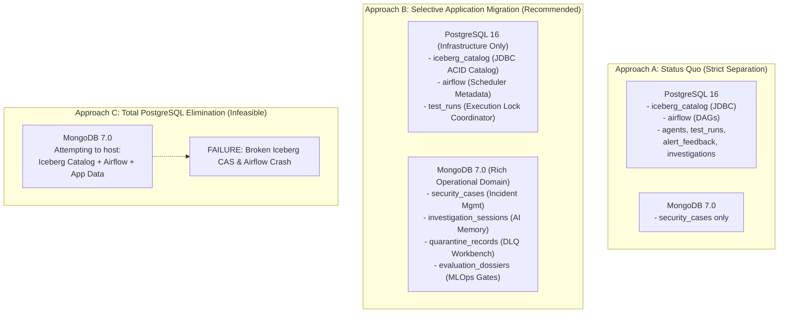
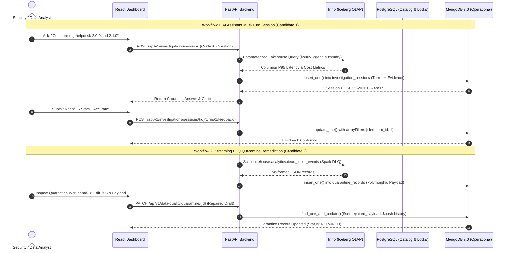

# AgentShield: MongoDB Service Expansion & Database Architecture Audit

**Document Reference:** `docs/MONGODB_EXPANSION_PROPOSAL.md`  
**Role:** Senior Big Data Engineer, MongoDB Specialist & Software Architect  
**Target Repository:** `AgentShield` (AI-Agent Observability, Reliability & Security Platform)  
**Status:** Candidate 1 (AI Assistant Multi-Turn Session Memory & Evaluation Store) **Fully Implemented, Tested, and Integrated** (See [`docs/MONGODB_QUERY_REFERENCE.md`](file:///c:/Users/Tapan/Downloads/BigDataPR/docs/MONGODB_QUERY_REFERENCE.md) and [`docs/INVESTIGATION_SESSIONS.md`](file:///c:/Users/Tapan/Downloads/BigDataPR/docs/INVESTIGATION_SESSIONS.md))  

---

## 1. Executive Summary

### 1.1 Project Context
AgentShield is an enterprise-grade AI-agent performance benchmarking, reliability monitoring, anomaly detection, and security governance platform. The current implementation features a robust, distributed data architecture:
- **Event Streaming:** Apache Kafka 3.9.0 (6 topics: `agent-traces`, `agent-metrics`, `agent-evaluations`, `agent-security-events`, `agent-alerts`, `agent-events-dlq`).
- **Stream Processing:** Apache Spark 3.5.3 Structured Streaming (two continuous streaming queries executing micro-batch validation, fan-out, and 1-minute tumbling window aggregations).
- **Analytical Telemetry (Lakehouse):** Apache Iceberg 1.7.1 table format storing columnar Parquet with Zstandard (ZSTD) compression on MinIO object storage (`warehouse/analytics`).
- **Interactive SQL Serving:** Trino 467 distributed query engine serving 51 parameterized SQL queries against the Iceberg lakehouse.
- **Relational Infrastructure & Operational State:** PostgreSQL 16 Alpine hosting three distinct databases (`iceberg_catalog`, `airflow`, and `agentshield`).
- **Operational Document Store:** MongoDB 7.0 Community Edition hosting mutable security investigation cases, collaborative timelines, and polymorphic evidence attachments (`security_cases`).
- **Backend API:** FastAPI 0.115.8 with SQLAlchemy 2.0.38 and PyMongo 4.11.1.
- **Web Dashboard:** React 18 with Vite, TypeScript, and Tailwind CSS across 13 interactive views.
- **Orchestration:** Apache Airflow 2.10.5 (`--profile orchestration`) executing scheduled regression checks, lakehouse maintenance, and anomaly model retraining.

### 1.2 Core Architectural Findings
A thorough audit was performed to address the primary architectural question:
> *"Why do we need both PostgreSQL and MongoDB? Could we use MongoDB for PostgreSQL's application-level data as well, while retaining the existing Big Data pipeline?"*

Our investigation reveals a clear technical boundary:
1. **PostgreSQL cannot be eliminated entirely.** The Apache Iceberg JDBC Catalog (`iceberg_catalog`) and the Apache Airflow Metadata Database (`airflow`) have rigid, non-negotiable relational dependencies. Neither Iceberg's Java `JdbcCatalog` nor Airflow's core scheduler supports MongoDB. Attempting to replace PostgreSQL completely (**Approach C**) is technically infeasible and would immediately break the streaming lakehouse and workflow orchestration.
2. **Selective application-level migration is viable and beneficial (**Approach B**).** The application database (`agentshield`) in PostgreSQL currently manages four tables: `agents`, `test_runs`, `alert_feedback`, and `investigations`. While `agents` and `test_runs` benefit from relational locking and tight worker integration, `investigations` and `alert_feedback` are operational, semi-structured records currently constrained by relational antipatterns (e.g., storing rich polymorphic evidence as flat JSON strings).
3. **Existing MongoDB capabilities are mature for security cases.** The repository already features a production-grade operational security case management system (`security_cases` collection) complete with `$jsonSchema` validation, compound and multikey indexing, full-text search, and multi-stage aggregation pipelines. Any additional MongoDB features must complement—not duplicate—this existing operational store.

### 1.3 Top 3 Ranked Expansion Candidates Summary
To satisfy Big Data curriculum requirements and demonstrate advanced NoSQL document patterns without rebuilding existing infrastructure, we recommend three non-overlapping, academically meaningful additions:

| Rank | Candidate Feature | Core Problem Solved | Primary MongoDB Concepts | Difficulty | Weighted Score (out of 5.0) |
|:---:|---|---|---|:---:|:---:|
| **1** | **AI Assistant Multi-Turn Session Memory & Evaluation Store** (`investigation_sessions`) | Upgrades the stateless, single-turn investigation assistant into a stateful, multi-turn conversational session store with turn-level analyst evaluation, groundedness verification, and evidence citations. Replaces flat PostgreSQL `investigations` table. | Embedded document arrays (`turns`), array update filters (`arrayFilters`), `$push`, `$inc`, `$facet` multi-faceted analytics, full-text search (`$text`). | **Easy–Intermediate** | **4.85 / 5.00** |
| **2** | **Streaming Dead-Letter (DLQ) & Data Quality Quarantine Workbench** (`quarantine_records`) | Bridges Spark Structured Streaming's immutable `dead_letter_events` in Iceberg with an operational remediation workbench to inspect malformed payloads, edit JSON schemas, triage validation faults, and track replay readiness. | Document polymorphism (arbitrary malformed JSON payloads), Time-To-Live (TTL) indexing (`expireAfterSeconds`), atomic state machine transitions (`$set`, `$addToSet`), histogram binning (`$bucket`). | **Easy–Intermediate** | **4.75 / 5.00** |
| **3** | **MLOps Agent Release Verification & Evaluation Dossier Store** (`evaluation_dossiers`) | Complements Iceberg's analytical `agent_regression_results` with operational release governance: multi-metric radar summaries, human sign-off approvals, risk waivers, and rollback certificates. | Hierarchical document modeling, compound unique indexing, `$unwind` and grouping over nested checks, atomic signature append (`$push`). | **Intermediate** | **4.45 / 5.00** |

---

## 2. Verified Current Database Architecture

The diagram below maps the verified data flows, protocols, and persistent storage boundaries across the AgentShield platform based on the audited codebase:

```mermaid
flowchart TD
    subgraph INGESTION ["1. Telemetry Ingestion & Streaming"]
        GEN["Deterministic Agent Generator<br/>(PRNG Workload Simulation)"]
        KAFKA["Apache Kafka 3.9.0 (KRaft)<br/>Port 9092 / 9094<br/>Topics: agent-traces, agent-metrics,<br/>agent-evaluations, agent-security-events,<br/>agent-alerts, agent-events-dlq"]
        SPARK["Apache Spark 3.5.3 Structured Streaming<br/>Query 1: lakehouse_fanout (10s micro-batch)<br/>Query 2: window_metrics_1m (30m watermark)"]
        GEN -->|Kafka Producer Protocol| KAFKA
        KAFKA -->|Continuous Micro-batch Read| SPARK
    end

    subgraph LAKEHOUSE ["2. Analytical Lakehouse (OLAP / Immutable)"]
        MINIO["MinIO Object Storage (S3 API)<br/>Port 9000 / 9001<br/>Bucket: warehouse/analytics<br/>Parquet Files (ZSTD Compressed)"]
        ICEBERG["Apache Iceberg 1.7.1 (Format v2)<br/>14 Tables: raw_agent_events, agent_spans,<br/>agent_run_metrics, agent_evaluation_results,<br/>agent_security_findings, dead_letter_events,<br/>hourly/daily summaries (T-Digest)"]
        TRINO["Trino 467 Distributed SQL Engine<br/>Port 8080<br/>Memory Limit: 512MB/query<br/>Serves 51 Analytical SQL Queries"]
        SPARK -->|Append-Only Parquet Commits| MINIO
        MINIO --- ICEBERG
        TRINO -->|Scan & Vectorized Query| ICEBERG
    end

    subgraph RELATIONAL ["3. Relational Infrastructure & State (PostgreSQL 16)"]
        PG["PostgreSQL 16 Alpine<br/>Port 5433 (host) / 5432 (internal)<br/>3 Distinct Databases"]
        DB_ICEBERG["DB: iceberg_catalog<br/>Tables: iceberg_tables, iceberg_namespace_properties<br/>Role: ACID Pointer Commits (V1 Schema)"]
        DB_AIRFLOW["DB: airflow<br/>~30 Relational Tables<br/>Role: DAG Runs, Task Instances, XCom"]
        DB_APP["DB: agentshield<br/>Tables: agents, test_runs,<br/>alert_feedback, investigations"]
        PG --- DB_ICEBERG
        PG --- DB_AIRFLOW
        PG --- DB_APP
        SPARK -.->|JDBC Catalog Commit CAS| DB_ICEBERG
        TRINO -.->|JDBC Catalog Table Lookup| DB_ICEBERG
        AIRFLOW["Apache Airflow 2.10.5<br/>Port 8088<br/>LocalExecutor"] -.->|SQLAlchemy / psycopg2| DB_AIRFLOW
    end

    subgraph OPERATIONAL ["4. Operational Document Store (MongoDB 7.0)"]
        MONGO["MongoDB 7.0 Jammy<br/>Port 27017<br/>Memory Limit: 512MB<br/>WiredTiger Cache: 0.25GB"]
        COL_CASES["Collection: security_cases<br/>- $jsonSchema Validation<br/>- 7 Indexes (Unique, Compound, Multikey, Text)<br/>- Mutable Lifecycle: OPEN -> RESOLVED<br/>- Collaborative Timelines & Evidence"]
        MONGO --- COL_CASES
    end

    subgraph SERVING ["5. Application & Visualization Layer"]
        FASTAPI["FastAPI 0.115.8 Backend API<br/>Port 8000<br/>10 Routers, 34 REST Endpoints"]
        REACT["React 18 Dashboard (Nginx)<br/>Port 3000<br/>13 Analytics & Governance Views"]
        FASTAPI -->|SQL Queries via HTTP| TRINO
        FASTAPI -->|SQLAlchemy 2.0 ORM| DB_APP
        FASTAPI -->|PyMongo Client (maxPool=10)| MONGO
        REACT -->|REST / JSON| FASTAPI
        FASTAPI -.->|One-Click Escalation Bridge| COL_CASES
    end
```

### 2.1 Pinned Service Configurations & Port Mappings
The active configuration was verified in [`docker-compose.yml`](file:///c:/Users/Tapan/Downloads/BigDataPR/docker-compose.yml), [`common/settings.py`](file:///c:/Users/Tapan/Downloads/BigDataPR/common/settings.py), and [`.env.example`](file:///c:/Users/Tapan/Downloads/BigDataPR/.env.example):

| Service Name | Docker Image / Tech | Container Name | Host Binding | Memory Limit | Key Environment Variables / Connection DSNs |
|---|---|---|---|---|---|
| `postgres` | `postgres:16-alpine` | `agentshield-postgres` | `127.0.0.1:5433:5432` | 512 MiB | `POSTGRES_DB=agentshield`, `ICEBERG_CATALOG_DB=iceberg_catalog`, `AIRFLOW_DB=airflow` |
| `mongodb` | `mongo:7.0-jammy` | `agentshield-mongodb` | `127.0.0.1:27017:27017` | 512 MiB | `MONGO_INITDB_DATABASE=agentshield`, `command: ["mongod", "--wiredTigerCacheSizeGB", "0.25"]` |
| `minio` | `bitnamilegacy/minio:2025.4.22` | `agentshield-minio` | `127.0.0.1:9000:9000`, `9001:9001` | 768 MiB | `MINIO_DEFAULT_BUCKETS=warehouse` |
| `kafka` | `apache/kafka:3.9.0` (KRaft) | `agentshield-kafka` | `127.0.0.1:9094:9094` | 768 MiB | `KAFKA_OFFSETS_TOPIC_REPLICATION_FACTOR=1` |
| `trino` | `trinodb/trino:467` | `agentshield-trino` | `127.0.0.1:8080:8080` | 2048 MiB | Catalogs: `lakehouse` (Iceberg via JDBC), `system` |
| `spark-streaming` | Custom PySpark 3.5.3 | `agentshield-spark` | `127.0.0.1:4040:4040` (UI) | 3072 MiB | `spark.sql.catalog.lakehouse.uri=jdbc:postgresql://postgres:5432/iceberg_catalog` |
| `backend` | Python 3.12 / FastAPI 0.115.8 | `agentshield-backend` | `127.0.0.1:8000:8000` | 512 MiB | `POSTGRES_DSN=postgresql+psycopg://...:5432/agentshield`, `MONGO_URI=mongodb://...:27017/agentshield` |
| `frontend` | React 18 / Nginx | `agentshield-frontend` | `127.0.0.1:3000:80` | 128 MiB | Proxies `/api/v1` to `backend:8000` |
| `airflow` | Airflow 2.10.5 | `agentshield-airflow` | `127.0.0.1:8088:8080` | 1536 MiB | `AIRFLOW__DATABASE__SQL_ALCHEMY_CONN=postgresql+psycopg2://...:5432/airflow` |

---

## 3. PostgreSQL Usage Inventory & Classification

Every occurrence of PostgreSQL across configuration files, infrastructure scripts, backend models, routers, and background services was audited. Below is the complete catalog and classification.

### 3.1 Detailed Usage Breakdown

```
+-------------------------------------------------------------------------------------------------------------------------+
|                                              POSTGRESQL USAGE INVENTORY                                                  |
+-------------------+----------------------------+-----------------------+-----------------------------+------------------+
| Database          | Table / Component          | Code / Config Path    | Primary Role                | Classification   |
+-------------------+----------------------------+-----------------------+-----------------------------+------------------+
| iceberg_catalog   | iceberg_tables             | infra/postgres/       | Atomic commit pointer for   | 1. Infrastructure|
|                   |                            | iceberg_catalog.sql   | Iceberg metadata.json       |    Critical      |
| iceberg_catalog   | iceberg_namespace_         | infra/postgres/       | Iceberg namespace properties| 1. Infrastructure|
|                   | properties                 | iceberg_catalog.sql   | and schema catalog metadata |    Critical      |
| airflow           | ~30 internal tables        | docker-compose.yml:254| Airflow orchestration,      | 1. Infrastructure|
|                   | (dag_run, task_instance...) | infra/airflow/        | task scheduling, XCom state |    Critical      |
| agentshield       | agents                     | backend/app/db.py:25  | Agent version registry      | 3. Retain in PG  |
|                   |                            | routers/agents.py     | (API-registered vs config)  |    (Sound Reason)|
| agentshield       | test_runs                  | backend/app/db.py:40  | Background execution queue  | 3. Retain in PG  |
|                   |                            | services/test_runner  | and thread lifecycle        |    (Sound Reason)|
| agentshield       | alert_feedback             | backend/app/db.py:54  | Analyst feedback on ML/rule | 2. Application   |
|                   |                            | routers/anomalies.py  | anomaly alerts              |    Suitable      |
| agentshield       | investigations             | backend/app/db.py:64  | Flat historical question-   | 2. Application   |
|                   |                            | routers/investigations| answer audit log            |    Suitable      |
| agentshield       | check_postgres()           | services/pipeline_    | Heartbeat ping (SELECT 1)   | 4. Operational   |
|                   |                            | health.py:151         | for system health status    |    Verification  |
| agentshield       | reset_demo.sh              | scripts/reset_demo.sh | TRUNCATE test_runs,         | 4. Operational   |
|                   |                            | line 43               | alert_feedback, inv...      |    Scripting     |
+-------------------+----------------------------+-----------------------+-----------------------------+------------------+
```

### 3.2 Classification Definitions & Technical Rationales

#### Category 1: Infrastructure-Critical Relational Metadata
- **`iceberg_catalog.iceberg_tables` & `iceberg_namespace_properties`:**
  * **Verified Fact:** Created by [`infra/postgres/iceberg_catalog.sql`](file:///c:/Users/Tapan/Downloads/BigDataPR/infra/postgres/iceberg_catalog.sql) (Iceberg JDBC Catalog Schema V1). Spark (`streaming/spark_job.py` line 76) and Trino (`infra/trino/catalog/lakehouse.properties` lines 7-8) connect via JDBC (`org.postgresql.Driver`).
  * **Technical Reason:** Apache Iceberg's table format requires an atomic Compare-And-Swap (CAS) mechanism to commit new table snapshots. The SQL query `UPDATE iceberg_tables SET metadata_location = ? WHERE catalog_name = ? AND table_namespace = ? AND table_name = ? AND metadata_location = ?` guarantees ACID snapshot isolation when multiple Spark streaming batches or Trino maintenance tasks commit concurrently.
  * **Feasibility of MongoDB Migration:** **Technically Infeasible.** Neither Apache Iceberg nor Trino provides a MongoDB catalog implementation. Attempting to point `iceberg.jdbc-catalog.driver-class` to MongoDB is impossible.

- **`airflow` Database (~30 relational tables):**
  * **Verified Fact:** Declared in [`docker-compose.yml`](file:///c:/Users/Tapan/Downloads/BigDataPR/docker-compose.yml) line 254: `AIRFLOW__DATABASE__SQL_ALCHEMY_CONN: postgresql+psycopg2://...:5432/airflow`. Initialized via `airflow db migrate`.
  * **Technical Reason:** Apache Airflow's core architecture requires an ACID RDBMS supported by SQLAlchemy (PostgreSQL, MySQL, SQLite) to manage distributed task locks, DAG run schedules, and worker heartbeats.
  * **Feasibility of MongoDB Migration:** **Technically Infeasible.** Apache Airflow does not support document stores or MongoDB as a metadata backend.

#### Category 2: Application-Owned Data Suitable for MongoDB Migration
- **`investigations` Table (`InvestigationLog` model in `backend/app/db.py`):**
  * **Verified Fact:** Defined with columns `id`, `question`, `intent`, `answer`, `evidence` (JSON list), `mode`, `created_at`.
  * **Why It is Suitable for MongoDB:** This table exhibits a classic relational antipattern. It serializes rich, polymorphic evidence objects into a rigid JSON string. Furthermore, it fails to record the query context (`test_run_id`, `trace_id`, `agent_id`), supports zero multi-turn conversational threading, and lacks analyst feedback ratings. Migrating this to a MongoDB collection (`investigation_sessions`) unlocks true document modeling: nested turns, polymorphic evidence arrays, text search, and multi-faceted aggregation.
- **`alert_feedback` Table (`AlertFeedback` model in `backend/app/db.py`):**
  * **Verified Fact:** Defined with columns `id`, `alert_id`, `verdict` (`useful` / `noisy` / `acknowledged`), `note`, `reviewer`, `created_at`.
  * **Why It is Suitable for MongoDB:** Alert feedback represents operational triage metadata created by human analysts reviewing Lakehouse anomaly alerts. Because anomaly alerts themselves are escalated into MongoDB security cases, storing triage and calibration feedback as document collections enables embedded review workflows.

#### Category 3: Data That Should Remain in PostgreSQL for Sound Technical Reasons
- **`agents` Table (`AgentRecord` model in `backend/app/db.py`):**
  * **Verified Fact:** Managed via [`backend/app/routers/agents.py`](file:///c:/Users/Tapan/Downloads/BigDataPR/backend/app/routers/agents.py). Stores agent dimensions registered via API (`source="api"`).
  * **Technical Reason:** The agent catalog is predominantly static, loaded from [`config/agents.yaml`](file:///c:/Users/Tapan/Downloads/BigDataPR/config/agents.yaml) at runtime. The database table serves only to register ad-hoc agent variants. It has strict foreign-key style uniqueness constraints (`agent_id`, `agent_version`) and low write frequency. Moving it to MongoDB adds zero document-modeling value.
- **`test_runs` Table (`TestRunRecord` model in `backend/app/db.py`):**
  * **Verified Fact:** Managed via [`backend/app/services/test_runner.py`](file:///c:/Users/Tapan/Downloads/BigDataPR/backend/app/services/test_runner.py). Tracks in-memory generator threads, progress updates (every 2 seconds), and orphan recovery (`recover_orphans()` during API startup in `backend/app/main.py`).
  * **Technical Reason:** `test_runs` functions as an operational execution queue and thread coordinator. Relational row-level locking (`SELECT ... FOR UPDATE` or atomic status updates) and exact ACID isolation are well-suited for thread supervision.

#### Category 4: Operational Verification & Scripting
- **`backend/app/services/pipeline_health.py` line 151:** `check_postgres()` runs `SELECT 1` to report relational health.
- **`scripts/reset_demo.sh` line 43:** Runs `TRUNCATE test_runs, alert_feedback, investigations; DELETE FROM agents;`.

---

## 4. Existing MongoDB Capability Audit

A comprehensive inspection of the existing MongoDB integration was conducted across [`infra/mongo/init-mongo.js`](file:///c:/Users/Tapan/Downloads/BigDataPR/infra/mongo/init-mongo.js), [`backend/app/mongo.py`](file:///c:/Users/Tapan/Downloads/BigDataPR/backend/app/mongo.py), [`backend/app/routers/cases.py`](file:///c:/Users/Tapan/Downloads/BigDataPR/backend/app/routers/cases.py), [`frontend/src/components/cases/CaseManagement.tsx`](file:///c:/Users/Tapan/Downloads/BigDataPR/frontend/src/components/cases/CaseManagement.tsx), and associated test suites.

### 4.1 Verified Active Implementation Inventory

```
+---------------------------------------------------------------------------------------------------------------+
|                                      AUDIT OF EXISTING MONGODB CAPABILITIES                                    |
+------------------------------+------------------------------------+-------------------------------------------+
| Architectural Dimension      | Current Implementation             | Code / File Citation                      |
+------------------------------+------------------------------------+-------------------------------------------+
| Target Database              | agentshield                        | docker-compose.yml:66, common/settings.py |
| Primary Collection           | security_cases                     | backend/app/mongo.py line 24              |
| Schema Validation            | $jsonSchema (BSON types, required  | infra/mongo/init-mongo.js lines 12-135    |
|                              | fields, regex patterns, enums)     | backend/app/mongo.py lines 26-149         |
| Embedded Subdocuments        | target_agent, assigned_analyst,    | backend/app/mongo.py lines 54-71, 129-140 |
|                              | remediation                        |                                           |
| Embedded Document Arrays     | linked_findings, evidence_bundle,  | backend/app/mongo.py lines 72-128         |
|                              | linked_anomaly_alerts, timeline    |                                           |
| Update Operators Used        | $set, $push, find_one_and_update   | backend/app/routers/cases.py:549-556, 585 |
| Update Operators Missing     | $addToSet, $inc, $pull, $pop,      | Not found in codebase                     |
|                              | $currentDate, arrayFilters         |                                           |
| Secondary Indexing           | 7 verified indexes (unique,        | infra/mongo/init-mongo.js lines 151-188   |
|                              | compound, multikey, text)          | backend/app/mongo.py lines 151-165        |
| Aggregation Pipelines        | 5 live pipelines in                | backend/app/routers/cases.py              |
|                              | /api/v1/cases/summary/analytics    | lines 231-313                             |
| Frontend Components          | CaseManagement.tsx, Security.tsx   | frontend/src/components/cases/            |
|                              | React Query hooks & types          | frontend/src/api/hooks.ts:244-290         |
| Test Coverage                | 24 unit & integration tests        | backend/tests/test_mongo_infra.py (8)     |
|                              | (Client pool, validation, indexes) | backend/tests/test_cases.py (16)          |
| Container Resources          | Memory limit 512m, cache 0.25GB    | docker-compose.yml lines 71, 78           |
+------------------------------+------------------------------------+-------------------------------------------+
```

### 4.2 Verified Indexes on `security_cases`
1. `idx_case_id_unique`: `{ case_id: 1 }` (Unique business key).
2. `idx_cases_triage_sla`: `{ status: 1, severity: 1, priority: 1, created_at: -1 }` (Compound index for operational triage filtering and SLA ordering).
3. `idx_cases_target_agent`: `{ "target_agent.agent_id": 1, "target_agent.agent_version": 1 }` (Compound index on embedded subdocument).
4. `idx_multikey_findings_finding_id`: `{ "linked_findings.finding_id": 1 }` (Multikey index on embedded array).
5. `idx_multikey_findings_trace_id`: `{ "linked_findings.trace_id": 1 }` (Multikey index linking lakehouse trace IDs).
6. `idx_multikey_alerts_alert_id`: `{ "linked_anomaly_alerts.alert_id": 1 }` (Multikey index linking anomaly alerts).
7. `idx_text_title_notes`: `{ title: "text", "timeline.notes": "text" }` (Compound full-text search index).

### 4.3 Verified Aggregation Pipelines
Implemented in `backend/app/routers/cases.py` under `GET /api/v1/cases/summary/analytics`:
- **Pipeline 1 (Status Breakdown):** `col.aggregate([{"$group": {"_id": "$status", "count": {"$sum": 1}}}])`
- **Pipeline 2 (Severity Breakdown):** `col.aggregate([{"$group": {"_id": "$severity", "count": {"$sum": 1}}}])`
- **Pipeline 3 (Active Cases by Agent):** `$match` on active statuses $\to$ `$group` on composite `_id: {agent_id, agent_version}` $\to$ conditional `$sum` with `$cond` for critical cases $\to$ `$project` $\to$ `$sort` $\to$ `$limit: 10`.
- **Pipeline 4 (Mean Time to Remediation - MTTR):** `$match` on resolved cases $\to$ `$project` with date math (`$subtract`, `$divide` by 3,600,000 to convert ms to hours) $\to$ `$group` by severity with `$avg`.
- **Pipeline 5 (Top Breached Policy Rules):** `$unwind: "$linked_findings"` $\to$ `$group` by `rule_id` $\to$ `$sort: {breach_count: -1}` $\to$ `$limit: 5`.

### 4.4 Missing MongoDB Concepts
While the existing implementation is solid, several key MongoDB concepts are **completely absent** from the repository:
1. **Time-To-Live (TTL) Indexes (`expireAfterSeconds`):** No automated document lifecycle management or data retention purging.
2. **Advanced Update Operators:**
   - `$addToSet`: Idempotent tag/label/metric addition without array duplication.
   - `$inc`: Atomic counter increments (e.g., attempt counters, view counts, score tallies).
   - `$pull` / `$pop`: Atomic removal of items from embedded arrays.
   - `arrayFilters`: Updating a specific matched sub-element inside an embedded array (e.g., updating rating on turn 3 without replacing the entire array).
3. **Multi-Faceted Aggregations (`$facet`):** Processing multiple analytical pipelines simultaneously in a single round-trip.
4. **Bucket & Histogram Aggregations (`$bucket` / `$bucketAuto`):** Grouping continuous data (latencies, token counts, error counts) into distinct analytical buckets.
5. **Referential Joins (`$lookup`):** Document enrichment across distinct collections within MongoDB.
6. **Change Streams (`watch()`):** Reactive operational updates.

---

## 5. Strategic Architectural Comparison: PostgreSQL vs MongoDB

To answer the core architectural question thoroughly, we analyze three distinct strategies.

### 5.1 The Three Evaluated Approaches



### 5.2 Comparative Analysis Matrix

| Evaluation Dimension | Approach A: Status Quo (Strict Separation) | Approach B: Selective Application Migration (Recommended) | Approach C: Total PostgreSQL Elimination (Infeasible) |
|---|---|---|---|
| **Architecture Overview** | PostgreSQL retains all infrastructure and application tables. MongoDB holds only `security_cases`. | PostgreSQL is retained strictly for infrastructure dependencies (`iceberg_catalog`, `airflow`, and thread coordinator `test_runs`). Suitable application data (`investigations`, `alert_feedback`) moves to MongoDB. | Attempt to replace PostgreSQL completely by migrating all tables, Iceberg catalog, and Airflow metadata to MongoDB. |
| **Technical Feasibility** | **100% Feasible** (Current working state). | **100% Feasible** (Clean incremental evolution). | **0% Feasible (Strictly Infeasible).** Broken at the engine level. |
| **Iceberg Compatibility** | Fully supported (`org.postgresql.Driver` JDBC catalog). | Fully supported (Retains PostgreSQL JDBC catalog). | **Broken.** Iceberg has no MongoDB catalog implementation. Spark streaming and Trino cannot commit or read table pointers. |
| **Airflow Compatibility** | Fully supported (SQLAlchemy PostgreSQL backend). | Fully supported (Retains PostgreSQL metadata DB). | **Broken.** Airflow does not support document stores as a metadata database. |
| **Data Modeling Fit** | Fair. Investigation history and feedback remain trapped in flat relational tables with stringified JSON blobs. | **Optimal.** Rich, multi-turn AI sessions, polymorphic evidence, and streaming DLQ payloads reside in natural BSON documents. | Poor. Forcing relational catalog transactions into MongoDB document models creates impedance mismatch. |
| **Migration Risk** | Zero risk (No changes). | **Very Low.** Clean migration with backward-compatible API endpoints and graceful degradation. | **Critical / Fatal.** Disables the core streaming Lakehouse and batch orchestration. |
| **Implementation Effort** | 0 Hours. | ~12–16 Hours (Incremental endpoints and schemas). | $\infty$ (Requires rewriting Iceberg and Airflow core internals). |
| **Big Data Academic Value** | Moderate. Polyglot persistence is demonstrated, but MongoDB is limited to a single collection. | **Exceptional.** Demonstrates textbook polyglot persistence: OLAP Lakehouse (Iceberg), Relational Infrastructure (PostgreSQL), and NoSQL Document Domain (MongoDB). | Negative. Demonstrates a fundamental misunderstanding of database engine trade-offs and catalog primitives. |

### 5.3 Architectural Recommendation & Viva Justification
- **Verdict:** Adopt **Approach B**.
- **Defense Explanation:** In an examination or viva, examiners look for architectural maturity. A naive student might say, *"MongoDB is modern, so let's delete PostgreSQL and put everything in MongoDB."* A senior architect explains:
  > *"We retain PostgreSQL specifically because Apache Iceberg's JDBC Catalog and Apache Airflow require ACID SQL semantics for atomic compare-and-swap (CAS) commit pointers and distributed execution locking. However, for operational application domains featuring polymorphic structures—such as multi-turn AI investigation sessions and streaming dead-letter remediation—we migrate those records to MongoDB 7.0. This achieves true Polyglot Persistence, where storage engines are selected based on workload access patterns and mutation lifecycles rather than dogmatic uniformity."*

---

## 6. The Top 3 Additional MongoDB Feature Proposals

We present three distinct, non-overlapping candidate additions, ranked from best to third-best.

---

### Candidate 1 (Rank 1 — Best Feature): AI Investigation Assistant Multi-Turn Session Memory & Evaluation Store

#### 1. Feature Name & Concrete Problem Solved
- **Feature Name:** Stateful AI Investigation Session Memory & Evaluation/Feedback Store (`investigation_sessions` collection).
- **Concrete Problem Solved:** The current investigation assistant ([`backend/app/routers/investigations.py`](file:///c:/Users/Tapan/Downloads/BigDataPR/backend/app/routers/investigations.py) and [`investigation/answer_service.py`](file:///c:/Users/Tapan/Downloads/BigDataPR/investigation/answer_service.py)) is completely stateless. Every question is an isolated query. The backend writes a flat record to PostgreSQL `investigations` table where the rich evidence array is serialized as raw JSON, the scoping context (`test_run_id`, `trace_id`, `agent_id`) is discarded upon persistence, multi-turn follow-ups are impossible, and there is zero user evaluation loop (no rating, verdict, or hallucination reporting).
- **Solution:** Migrate and expand this application domain into a dedicated MongoDB collection (`investigation_sessions`). It stores stateful multi-turn investigation sessions, embeds full context and evidence citations, and enables analysts to submit turn-level feedback ratings and hallucination flags.

#### 2. Existing Code & Data Reused
- Reuses [`investigation/answer_service.py`](file:///c:/Users/Tapan/Downloads/BigDataPR/investigation/answer_service.py) (`Answer`, `Evidence`, `Context` dataclasses).
- Reuses [`investigation/retrieval.py`](file:///c:/Users/Tapan/Downloads/BigDataPR/investigation/retrieval.py) and TF-IDF runbook index.
- Reuses [`frontend/src/pages/Assistant.tsx`](file:///c:/Users/Tapan/Downloads/BigDataPR/frontend/src/pages/Assistant.tsx) (`ExchangeView`, context selector, example chips).
- Replaces PostgreSQL model `InvestigationLog` in [`backend/app/db.py`](file:///c:/Users/Tapan/Downloads/BigDataPR/backend/app/db.py) line 64.

#### 3. Exact Proposed MongoDB Collection & Example Document Structure
- **Collection:** `investigation_sessions`
- **Schema Validation:** Enforced via `$jsonSchema`.
- **Example Document:**

```json
{
  "_id": "ObjectId('671fb2c0e4b0a1b2c3d4e501')",
  "session_id": "SESS-202610-7f2a1b",
  "title": "Investigation: P95 Latency Spike on rag-helpdesk 2.1.0",
  "analyst": "sarah.chen",
  "scope_context": {
    "test_run_id": "TR-20261010-065853",
    "agent_id": "rag-helpdesk",
    "agent_version": "2.1.0",
    "baseline_version": "2.0.0",
    "trace_id": "a1b2c3d4e5f60718293a4b5c6d7e8f90"
  },
  "turn_count": 2,
  "status": "ACTIVE",
  "turns": [
    {
      "turn_id": 1,
      "question": "Compare rag-helpdesk 2.0.0 and 2.1.0 for latency and cost.",
      "intent": "compare_versions",
      "mode": "deterministic",
      "grounded": true,
      "answer": "Comparing rag-helpdesk versions:\n- P95 Latency: 2.0.0 was 1,240 ms; 2.1.0 is 2,480 ms (+100.0% increase).\n- Estimated Cost / 1k tasks: $4.12 vs $4.15 (+0.7%).\nVerdict: Latency regression detected.",
      "evidence": [
        {
          "kind": "metric",
          "ref": "lakehouse.analytics.hourly_agent_summary",
          "title": "P95 Latency Aggregate",
          "detail": "Measured across 10,000 runs per cohort."
        },
        {
          "kind": "document",
          "ref": "investigation/knowledge_base/latency_runbook.md",
          "title": "Vector Retrieval Bottlenecks",
          "detail": "Section 3: Chunk size expansion impact."
        }
      ],
      "suggested_questions": [
        "Why did run R-104 fail?",
        "Show the main causes of timeouts during the last test."
      ],
      "feedback": {
        "rating": 5,
        "verdict": "accurate",
        "notes": "Verified numbers match Trino lakehouse query directly.",
        "submitted_at": "2026-10-28T21:15:00Z"
      },
      "created_at": "2026-10-28T21:14:30Z"
    },
    {
      "turn_id": 2,
      "question": "What caused the latency increase in 2.1.0?",
      "intent": "timeout_causes",
      "mode": "llm",
      "grounded": true,
      "answer": "Trace inspection shows tool 'vector_search_v2' expanded top-k from 5 to 20 documents, causing downstream LLM context expansion.",
      "evidence": [
        {
          "kind": "trace",
          "ref": "a1b2c3d4e5f60718293a4b5c6d7e8f90",
          "title": "Span: vector_search_v2",
          "detail": "Duration 1,840 ms; tokens 3,200."
        }
      ],
      "suggested_questions": [],
      "feedback": null,
      "created_at": "2026-10-28T21:16:10Z"
    }
  ],
  "tags": ["latency", "rag-helpdesk", "regression"],
  "created_at": "2026-10-28T21:14:30Z",
  "updated_at": "2026-10-28T21:16:10Z"
}
```

#### 4. Important CRUD Operations & 5 Meaningful MongoDB Queries
- **Operation 1: Create Session with First Turn** (`insert_one`)
- **Operation 2: Append Turn to Active Session** (`find_one_and_update` with `$push` and `$inc`)
- **Operation 3: Submit Turn Feedback with Array Filter** (`find_one_and_update` with `arrayFilters`)
- **Operation 4: Full-Text Search Across Questions & Answers** (`$text`)
- **Operation 5: Multi-Faceted Evaluation Analytics Pipeline** (`$facet`, `$bucket`, `$group`)

```python
# Query 1: Append a new conversation turn and atomically increment turn_count
db.investigation_sessions.find_one_and_update(
    {"session_id": "SESS-202610-7f2a1b", "status": "ACTIVE"},
    {
        "$push": {"turns": new_turn_dict},
        "$inc": {"turn_count": 1},
        "$set": {"updated_at": datetime.now(timezone.utc)},
    },
    return_document=ReturnDocument.AFTER,
)

# Query 2: Atomic turn feedback submission using arrayFilters
db.investigation_sessions.update_one(
    {"session_id": "SESS-202610-7f2a1b"},
    {"$set": {"turns.$[elem].feedback": feedback_dict, "updated_at": datetime.now(timezone.utc)}},
    array_filters=[{"elem.turn_id": 2}],
)

# Query 3: Multi-attribute compound search with text search and context filtering
db.investigation_sessions.find({
    "$text": {"$search": "latency regression vector_search"},
    "scope_context.agent_id": "rag-helpdesk",
    "status": "ACTIVE",
}).sort([("score", {"$meta": "textScore"}), ("updated_at", -1)]).limit(10)

# Query 4: Multi-turn session length histogram and intent transitions
db.investigation_sessions.aggregate([
    {"$unwind": "$turns"},
    {
        "$group": {
            "_id": "$turns.intent",
            "total_queries": {"$sum": 1},
            "avg_rating": {"$avg": "$turns.feedback.rating"},
            "hallucination_reports": {
                "$sum": {"$cond": [{"$eq": ["$turns.feedback.verdict", "hallucination"]}, 1, 0]}
            },
            "grounded_count": {"$sum": {"$cond": ["$turns.grounded", 1, 0]}},
        }
    },
    {"$sort": {"total_queries": -1}},
])

# Query 5: Comprehensive evaluation dashboard using $facet (Multi-pipeline in 1 roundtrip)
db.investigation_sessions.aggregate([
    {
        "$facet": {
            "mode_breakdown": [
                {"$unwind": "$turns"},
                {"$group": {"_id": "$turns.mode", "count": {"$sum": 1}, "avg_rating": {"$avg": "$turns.feedback.rating"}}}
            ],
            "session_depth_distribution": [
                {"$bucket": {
                    "groupBy": "$turn_count",
                    "boundaries": [1, 2, 4, 8, 20],
                    "default": "20+",
                    "output": {"sessions": {"$sum": 1}}
                }}
            ],
            "top_investigated_agents": [
                {"$group": {"_id": "$scope_context.agent_id", "session_count": {"$sum": 1}}},
                {"$sort": {"session_count": -1}},
                {"$limit": 5}
            ]
        }
    }
])
```

#### 5. Specific MongoDB Concepts Demonstrated
- **Embedded Document Arrays (`turns`):** Stores conversational memory together in a single document, avoiding relational joins.
- **`arrayFilters` Updates:** Surgical in-place updates of a specific turn's feedback subdocument.
- **Update Operators:** Demonstrates `$push`, `$inc`, `$set`, and `$addToSet` (for session tags).
- **Compound & Multikey Indexes:**
  * `{ "analyst": 1, "updated_at": -1 }`
  * `{ "scope_context.agent_id": 1, "scope_context.agent_version": 1 }`
  * `{ "turns.evidence.ref": 1 }` (Multikey index over nested citations)
  * `{ title: "text", "turns.question": "text", "turns.answer": "text" }` (Full-text search)
- **Aggregation Pipeline:** `$facet`, `$unwind`, `$bucket`, `$cond`, and statistical `$avg`.
- **`$jsonSchema` Validation:** Strict type and enum validation for session lifecycle.

#### 6. Files Likely to Change
- **Backend:** [`backend/app/routers/investigations.py`](file:///c:/Users/Tapan/Downloads/BigDataPR/backend/app/routers/investigations.py) (add session endpoints), [`backend/app/mongo.py`](file:///c:/Users/Tapan/Downloads/BigDataPR/backend/app/mongo.py) (add schema and indexes).
- **Frontend:** [`frontend/src/pages/Assistant.tsx`](file:///c:/Users/Tapan/Downloads/BigDataPR/frontend/src/pages/Assistant.tsx) (session switcher drawer, turn feedback stars/thumbs, citation links).
- **Infrastructure:** [`infra/mongo/init-mongo.js`](file:///c:/Users/Tapan/Downloads/BigDataPR/infra/mongo/init-mongo.js) (collection bootstrap).

#### 7. Expected Implementation Difficulty
- **Easy–Intermediate.** Reuses existing prompt/answer pipeline; adds CRUD and session persistence.

#### 8. Dependencies & Compatibility Risks
- **Zero Risk.** Does not alter Kafka schemas or Spark streaming. Operates in degraded mode if MongoDB is offline.

#### 9. Test Plan & Live Demonstration Scenario
- **Test Plan:** 8 PyTest cases verifying session creation, multi-turn appending, `arrayFilters` feedback update, text search scoring, and `$facet` analytics.
- **Live Demo Scenario:**
  1. Open Assistant in React UI; select context: `rag-helpdesk 2.1.0`.
  2. Ask: *"Compare rag-helpdesk 2.0.0 and 2.1.0 for latency"*. Receive grounded response.
  3. Ask follow-up in the same session: *"What caused this latency spike?"*.
  4. Click "Rate Answer" (5 stars, verdict: "Accurate").
  5. Run `python scripts/inspect_mongo.py --sessions` to show faculty the complete multi-turn JSON document and live evaluation aggregation.

#### 10. Academic & Practical Value
- **Academic:** Demonstrates GenAI operational state management, LLM evaluation pipelines (groundedness vs hallucination tracking), and multi-faceted document aggregation.
- **Practical:** Solves the stateless assistant limitation and eliminates the flat PostgreSQL `investigations` antipattern.

#### 11. Overlap Check
- **Zero Overlap.** Focuses strictly on conversational Q&A and LLM evaluation; does not duplicate `security_cases`.

#### 12. Estimated Effort
- **10–12 Hours** (Labeled Estimate: Backend router & schemas: 4h; Frontend feedback drawer: 4h; Tests & docs: 3h).

---

### Candidate 2 (Rank 2 — Second-Best Feature): Streaming Dead-Letter Queue (DLQ) & Data Quality Remediation Workbench

#### 1. Feature Name & Concrete Problem Solved
- **Feature Name:** Streaming Dead-Letter Queue (DLQ) & Data Quality Remediation Store (`quarantine_records` collection).
- **Concrete Problem Solved:** Spark Structured Streaming continuously quarantines malformed or schema-violating events into the Iceberg table `dead_letter_events` ([`streaming/spark_job.py`](file:///c:/Users/Tapan/Downloads/BigDataPR/streaming/spark_job.py) line 339, [`sql/01_schema_and_tables.sql`](file:///c:/Users/Tapan/Downloads/BigDataPR/sql/01_schema_and_tables.sql) line 53). However, Iceberg is an immutable Parquet lakehouse format. There is **no operational workflow** to inspect, categorize, annotate, repair malformed JSON payloads, track data-quality triage status, or prepare repaired records for pipeline re-injection.
- **Solution:** An operational Data Quality Quarantine Workbench backed by MongoDB. Quarantined records can be promoted into mutable remediation files where data engineers can inspect the root validation error, draft repaired BSON payloads, track triage states (`QUARANTINED -> IN_REVIEW -> REPAIRED -> REPLAYED -> DISMISSED`), and auto-expire resolved issues using TTL indexes.

#### 2. Existing Code & Data Reused
- Reuses `lakehouse.analytics.dead_letter_events` in Iceberg.
- Reuses [`ingestion/validation.py`](file:///c:/Users/Tapan/Downloads/BigDataPR/ingestion/validation.py) (`DirtyDataInjector`, `dead_letter()`).
- Reuses `sql/06_data_quality_checks.sql` and `frontend/src/pages/Quality.tsx`.

#### 3. Exact Proposed MongoDB Collection & Example Document Structure
- **Collection:** `quarantine_records`
- **Schema Validation:** Enforced via `$jsonSchema`.
- **Example Document:**

```json
{
  "_id": "ObjectId('671fb350e4b0a1b2c3d4e502')",
  "quarantine_id": "DQ-202610-0019",
  "source_event": {
    "topic": "agent-traces",
    "partition": 2,
    "offset": 45102,
    "batch_id": 142,
    "producer": "generator-worker-3",
    "kafka_timestamp": "2026-10-28T20:45:10Z"
  },
  "error_classification": {
    "category": "contract_violation",
    "rule_violated": "MISSING_REQUIRED_FIELD",
    "validation_error": "EventValidationError: 'trace_id' must be a 32-character hexadecimal string, got null"
  },
  "raw_payload": "{\"event_id\":\"e102-uuid\",\"event_type\":\"agent_span\",\"span_name\":\"tool_call\",\"trace_id\":null}",
  "parsed_payload": {
    "event_id": "e102-uuid",
    "event_type": "agent_span",
    "span_name": "tool_call",
    "trace_id": null
  },
  "status": "IN_REVIEW",
  "priority": "P2",
  "assigned_engineer": "alex.kumar",
  "repaired_payload": {
    "event_id": "e102-uuid",
    "event_type": "agent_span",
    "span_name": "tool_call",
    "trace_id": "8f7a6b5c4d3e2f1a0b9c8d7e6f5a4b3c"
  },
  "remediation_history": [
    {
      "timestamp": "2026-10-28T21:00:15Z",
      "author": "system",
      "action": "QUARANTINED",
      "notes": "Ingested from Spark DLQ stream."
    },
    {
      "timestamp": "2026-10-28T21:05:00Z",
      "author": "alex.kumar",
      "action": "DRAFT_REPAIR",
      "notes": "Correlated trace_id from parent session logs and populated field."
    }
  ],
  "replay_attempts": 0,
  "created_at": "2026-10-28T21:00:15Z",
  "updated_at": "2026-10-28T21:05:00Z",
  "ttl_expiry": "2026-11-27T21:00:15Z"
}
```

#### 4. Important CRUD Operations & 5 Meaningful MongoDB Queries
- **Operation 1: Quarantine Ingestion** (`insert_one`)
- **Operation 2: Draft Repaired Payload** (`find_one_and_update` with `$set` and `$push`)
- **Operation 3: Mark Replayed with Atomic Counter Increment** (`$set` and `$inc`)
- **Operation 4: Tag Error Patterns Without Duplication** (`$addToSet`)
- **Operation 5: Data Quality Root-Cause Aggregation** (`$group`, `$bucket`, `$project`)

```python
# Query 1: Promote/ingest a dead-letter event from Trino lakehouse into MongoDB
db.quarantine_records.insert_one(quarantine_doc)

# Query 2: Apply draft repair and append audit note
db.quarantine_records.find_one_and_update(
    {"quarantine_id": "DQ-202610-0019", "status": "IN_REVIEW"},
    {
        "$set": {
            "repaired_payload": repaired_json,
            "status": "REPAIRED",
            "updated_at": datetime.now(timezone.utc),
        },
        "$push": {
            "remediation_history": {
                "timestamp": datetime.now(timezone.utc),
                "author": "alex.kumar",
                "action": "PAYLOAD_REPAIRED",
                "notes": "Corrected schema violation for replay.",
            }
        },
    },
    return_document=ReturnDocument.AFTER,
)

# Query 3: Idempotently add triage tags and increment replay count
db.quarantine_records.update_one(
    {"quarantine_id": "DQ-202610-0019"},
    {
        "$addToSet": {"tags": {"$each": ["corrupted_trace", "generator_bug"]}},
        "$inc": {"replay_attempts": 1},
        "$set": {"status": "REPLAYED"},
    },
)

# Query 4: Categorical data-quality error pattern aggregation
db.quarantine_records.aggregate([
    {"$match": {"status": {"$in": ["QUARANTINED", "IN_REVIEW"]}}},
    {
        "$group": {
            "_id": {
                "category": "$error_classification.category",
                "producer": "$source_event.producer",
            },
            "unresolved_count": {"$sum": 1},
            "earliest_breach": {"$min": "$created_at"},
            "latest_breach": {"$max": "$created_at"},
        }
    },
    {"$sort": {"unresolved_count": -1}},
])

# Query 5: Batch-size histogram aggregation using $bucket
db.quarantine_records.aggregate([
    {
        "$bucket": {
            "groupBy": "$source_event.batch_id",
            "boundaries": [0, 50, 100, 150, 200, 500],
            "default": "Other",
            "output": {
                "quarantine_count": {"$sum": 1},
                "distinct_rules": {"$addToSet": "$error_classification.rule_violated"},
            },
        }
    }
])
```

#### 5. Specific MongoDB Concepts Demonstrated
- **Document Polymorphism:** `raw_payload` and `repaired_payload` handle arbitrary JSON shapes without schema alteration.
- **Time-To-Live (TTL) Indexing:** `db.quarantine_records.createIndex({ "ttl_expiry": 1 }, { expireAfterSeconds: 0 })` automatically removes resolved records after 30 days.
- **Update Operators:** Demonstrates `$addToSet`, `$inc`, `$set`, and `$push`.
- **Aggregation Histogram (`$bucket`):** Analyzes error distributions across streaming micro-batches.

#### 6. Files Likely to Change
- **Backend:** New router `backend/app/routers/data_quality.py`, updates to [`backend/app/mongo.py`](file:///c:/Users/Tapan/Downloads/BigDataPR/backend/app/mongo.py).
- **Frontend:** New tab in [`frontend/src/pages/Quality.tsx`](file:///c:/Users/Tapan/Downloads/BigDataPR/frontend/src/pages/Quality.tsx) for "Quarantine Workbench (MongoDB)".
- **Infrastructure:** Updates to [`infra/mongo/init-mongo.js`](file:///c:/Users/Tapan/Downloads/BigDataPR/infra/mongo/init-mongo.js).

#### 7. Expected Implementation Difficulty
- **Easy–Intermediate.** Reuses existing Lakehouse dead-letter facts and connects to FastAPI.

#### 8. Dependencies & Compatibility Risks
- **Low Risk.** Operates as an out-of-band operational store; does not impact Spark streaming execution.

#### 9. Test Plan & Live Demonstration Scenario
- **Test Plan:** Unit tests verifying schema validation, TTL index creation, and payload repair updates.
- **Live Demo Scenario:**
  1. Trigger test run with injected dirty data: `dirty_rate=0.05`.
  2. Spark flags invalid events into Iceberg `dead_letter_events`.
  3. Open Data Quality tab in UI; click "Import to Remediation Workbench".
  4. Edit payload JSON in the modal, click "Save Draft Repair".
  5. Inspect the MongoDB document to show faculty the audit history and polymorphic repaired payload.

#### 10. Academic & Practical Value
- **Academic:** Demonstrates modern streaming data-quality lifecycle: Bronze Quarantine $\to$ Operational Triage $\to$ Repaired Replay.
- **Practical:** Transforms a passive dead-letter table into an actionable remediation workbench.

#### 11. Overlap Check
- **Zero Overlap.** Focuses strictly on data engineering and streaming schema violations; does not manage security policy breaches.

#### 12. Estimated Effort
- **12–14 Hours** (Labeled Estimate: Backend router & schemas: 4h; Frontend editor UI: 5h; Tests & docs: 3h).

---

### Candidate 3 (Rank 3 — Third-Best Feature): MLOps Agent Release Verification & Evaluation Dossier Store

#### 1. Feature Name & Concrete Problem Solved
- **Feature Name:** MLOps Agent Release Verification & Evaluation Dossier Store (`evaluation_dossiers` collection).
- **Concrete Problem Solved:** The regression gate ([`evaluation/regression_gate.py`](file:///c:/Users/Tapan/Downloads/BigDataPR/evaluation/regression_gate.py)) compares candidate vs baseline agent cohorts and writes flat rows into Iceberg table `agent_regression_results` ([`backend/app/routers/test_runs.py`](file:///c:/Users/Tapan/Downloads/BigDataPR/backend/app/routers/test_runs.py) lines 170–183). However, when enterprise release decisions occur, organizations need an operational **Release Dossier / Verification Certificate**:
  - Who signed off on or rejected the release?
  - What were the engineering justifications, risk waivers, and rollback configurations?
  - Iceberg stores raw numerical check rows; it cannot capture collaborative sign-offs, cryptographic signatures, or waiver workflows.
- **Solution:** An operational Release Governance Store in MongoDB. It captures complete multi-metric evaluation dossiers, reviewer approval signatures, risk waivers, and verified rollback plans.

#### 2. Existing Code & Data Reused
- Reuses [`evaluation/regression_gate.py`](file:///c:/Users/Tapan/Downloads/BigDataPR/evaluation/regression_gate.py) (`run_gate()`, `Cohort`, `Check` dataclasses).
- Reuses `lakehouse.analytics.agent_regression_results` and `agent_evaluation_results`.
- Reuses [`frontend/src/pages/TestingLab.tsx`](file:///c:/Users/Tapan/Downloads/BigDataPR/frontend/src/pages/TestingLab.tsx) and [`frontend/src/pages/Reports.tsx`](file:///c:/Users/Tapan/Downloads/BigDataPR/frontend/src/pages/Reports.tsx).

#### 3. Exact Proposed MongoDB Collection & Example Document Structure
- **Collection:** `evaluation_dossiers`
- **Schema Validation:** Enforced via `$jsonSchema`.
- **Example Document:**

```json
{
  "_id": "ObjectId('671fb400e4b0a1b2c3d4e503')",
  "dossier_id": "REL-202610-0042",
  "agent_id": "rag-helpdesk",
  "candidate_version": "2.1.0",
  "baseline_version": "2.0.0",
  "gate_verdict": "NEEDS_REVIEW",
  "statistical_summary": {
    "baseline_runs": 10000,
    "candidate_runs": 10000,
    "success_p_value": 0.042,
    "statistically_significant": true
  },
  "checks": [
    {
      "check_name": "success_rate_drop",
      "status": "pass",
      "baseline": 0.965,
      "candidate": 0.958,
      "delta": -0.007,
      "threshold": -0.02
    },
    {
      "check_name": "p95_latency_increase",
      "status": "review",
      "baseline": 1240.0,
      "candidate": 1680.0,
      "delta": 35.48,
      "threshold": 30.0
    }
  ],
  "governance": {
    "status": "APPROVED_WITH_WAIVER",
    "approvals": [
      {
        "reviewer": "lead_architect",
        "decision": "WAIVED",
        "reason": "Latency increase acceptable due to 20% higher document retrieval accuracy.",
        "signed_at": "2026-10-28T21:10:00Z"
      }
    ],
    "rollback_plan": {
      "target_version": "2.0.0",
      "automated_fallback": true,
      "verified": true
    }
  },
  "created_at": "2026-10-28T21:00:00Z",
  "updated_at": "2026-10-28T21:10:00Z"
}
```

#### 4. Important CRUD Operations & 5 Meaningful MongoDB Queries
- **Operation 1: Create Dossier from Lakehouse Regression Gate** (`insert_one`)
- **Operation 2: Append Reviewer Approval Signature** (`find_one_and_update` with `$push`)
- **Operation 3: Update Release Status with Concurrency Check** (`$set`)
- **Operation 4: Aggregate Pass/Fail Ratios Across Agent Versions** (`$group`)
- **Operation 5: Identify Most Frequent Failing Checks Across All Releases** (`$unwind`, `$group`, `$sort`)

```python
# Query 1: Insert new release evaluation dossier
db.evaluation_dossiers.insert_one(dossier_doc)

# Query 2: Append approval signature and update governance status
db.evaluation_dossiers.find_one_and_update(
    {"dossier_id": "REL-202610-0042", "governance.status": "PENDING_REVIEW"},
    {
        "$set": {"governance.status": "APPROVED", "updated_at": datetime.now(timezone.utc)},
        "$push": {"governance.approvals": approval_entry},
    },
    return_document=ReturnDocument.AFTER,
)

# Query 3: Search dossiers by agent and verdict
db.evaluation_dossiers.find({
    "agent_id": "rag-helpdesk",
    "gate_verdict": {"$in": ["NEEDS_REVIEW", "FAILED"]},
}).sort("created_at", -1).limit(10)

# Query 4: Most frequent failing regression checks across all agents
db.evaluation_dossiers.aggregate([
    {"$unwind": "$checks"},
    {"$match": {"checks.status": {"$in": ["fail", "review"]}}},
    {
        "$group": {
            "_id": "$checks.check_name",
            "fail_count": {"$sum": 1},
            "avg_delta": {"$avg": "$checks.delta"},
        }
    },
    {"$sort": {"fail_count": -1}},
])

# Query 5: Governance sign-off latency and waiver frequency
db.evaluation_dossiers.aggregate([
    {"$match": {"governance.status": "APPROVED_WITH_WAIVER"}},
    {
        "$group": {
            "_id": "$agent_id",
            "waiver_count": {"$sum": 1},
            "last_waiver_date": {"$max": "$created_at"},
        }
    },
    {"$sort": {"waiver_count": -1}},
])
```

#### 5. Specific MongoDB Concepts Demonstrated
- **Hierarchical Document Modeling:** Combines statistical test results with human approval workflows.
- **Compound Unique Indexing:** `{ "agent_id": 1, "candidate_version": 1 }` guarantees one active release dossier per candidate version.
- **Array Aggregation:** `$unwind` on nested check arrays to compute cross-agent failure trends.

#### 6. Files Likely to Change
- **Backend:** Update [`backend/app/routers/test_runs.py`](file:///c:/Users/Tapan/Downloads/BigDataPR/backend/app/routers/test_runs.py), update [`backend/app/mongo.py`](file:///c:/Users/Tapan/Downloads/BigDataPR/backend/app/mongo.py).
- **Frontend:** Update [`frontend/src/pages/TestingLab.tsx`](file:///c:/Users/Tapan/Downloads/BigDataPR/frontend/src/pages/TestingLab.tsx) with a "Release Sign-off" drawer.

#### 7. Expected Implementation Difficulty
- **Intermediate.** Requires wiring regression gate outputs to the sign-off workflow.

#### 8. Dependencies & Compatibility Risks
- **Low Risk.** Purely additive operational layer over existing Iceberg regression results.

#### 9. Test Plan & Live Demonstration Scenario
- **Test Plan:** Tests for unique release dossier creation, sign-off validation, and check aggregation.
- **Live Demo Scenario:** Run regression gate in UI; promote results to Release Dossier; sign off as lead architect with a waiver.

#### 10. Academic & Practical Value
- **Academic:** Demonstrates MLOps / LLMOps release governance and compliance auditing.
- **Practical:** Solves the gap between raw statistical output and production deployment sign-off.

#### 11. Overlap Check
- **Zero Overlap.** Governs agent deployment releases; distinct from security incident cases.

#### 12. Estimated Effort
- **14–16 Hours** (Labeled Estimate: Backend router & schemas: 5h; Frontend governance UI: 6h; Tests & docs: 4h).

---

## 7. Big Data Subject Requirements Alignment

Each recommended feature genuinely aligns with core Big Data curriculum competencies:

```
+----------------------------------------------------------------------------------------------------------------------+
|                                     BIG DATA SUBJECT REQUIREMENTS ALIGNMENT MATRIX                                   |
+--------------------------+-------------------------------------+-----------------------------------------------------+
| Big Data Concept         | Candidate 1: AI Assistant Memory    | Candidate 2: Streaming DLQ Workbench                |
+--------------------------+-------------------------------------+-----------------------------------------------------+
| Volume, Velocity &       | Variety: Stores polymorphic         | Velocity & Variety: Handles malformed streaming     |
| Variety                  | evidence citations (SQL, metrics,   | micro-batch events of unpredictable structure       |
|                          | traces, Markdown runbooks).         | without breaking rigid database schemas.            |
| Streaming-to-Storage     | Operational RAG loop: Queries       | Direct Lakehouse Bridge: Connects Spark Streaming   |
| Workflows                | Trino Lakehouse for real-time       | Bronze dead_letter_events directly to an operational|
|                          | evidence generation.                | remediation and repair workflow.                    |
| Analytical vs            | Clear boundary: Iceberg stores      | Clear boundary: Iceberg stores immutable audit logs |
| Operational Workloads    | immutable event telemetry; MongoDB  | of corrupt rows; MongoDB provides mutable drafting  |
|                          | handles sub-millisecond turn writes.| and triage state machines.                          |
| NoSQL Document           | Hierarchical turn embedding with    | Polymorphic documents capturing variable payload    |
| Modeling                 | nested evidence and feedback.       | errors; TTL index for automatic retention purging.  |
| Query Optimization       | Multikey indexing on citation refs; | Compound indexing on topic/partition/status;       |
| & Indexing               | compound text search index.         | TTL index on expiry timestamp.                      |
| Aggregation &            | $facet multi-pipeline execution;    | $bucket micro-batch grouping; categorical error     |
| Operational Analytics    | $bucket session depth analysis.     | classification with conditional aggregations.       |
| Fault Handling &         | Tracks model hallucination rates    | Provides end-to-end fault remediation, triage, and  |
| Reliability              | and answer groundedness.            | replay lifecycle for streaming pipelines.           |
| Polyglot Persistence     | Replaces flat PostgreSQL table with | Complements Iceberg Parquet files with mutable      |
| & Data Ownership         | document-oriented state store.      | operational quarantine documents.                   |
+--------------------------+-------------------------------------+-----------------------------------------------------+
```

---

## 8. Weighted Scoring and Final Recommendation

### 8.1 Scoring Methodology & Criteria Weights
To provide an objective, academic ranking, each candidate was evaluated across six weighted criteria:
1. **MongoDB Concept Coverage (25%):** Depth of document modeling, update operators (`$push`, `arrayFilters`, `$inc`, `$addToSet`), indexing (TTL, multikey, text), and aggregation pipelines (`$facet`, `$bucket`).
2. **Big Data Academic Relevance (20%):** Relevance to streaming pipelines, data quality, Lakehouse integration, and Polyglot Persistence.
3. **Practical Value to AgentShield (20%):** Measurable utility to the existing platform without building redundant workflows.
4. **Implementation Simplicity (15%):** Ease of development, low architectural friction, and clean incremental delivery.
5. **Compatibility with Current Architecture (10%):** Freedom from regressions in Kafka, Spark, Iceberg, and Docker Compose memory constraints.
6. **Demonstration Quality for Faculty (10%):** Ability to deliver a compelling, visually clear live demonstration during an examination.

### 8.2 Detailed Weighted Scoring Table

| Evaluation Criterion | Weight | Candidate 1: AI Assistant Memory & Evaluation | Candidate 2: Streaming DLQ Workbench | Candidate 3: Agent Release Dossiers |
|---|:---:|:---:|:---:|:---:|
| **MongoDB Concept Coverage** | 25% | **5.00** *(arrayFilters, $facet, $inc, text)* | **4.80** *(TTL, polymorphism, $bucket, $addToSet)* | **4.20** *($unwind, compound unique)* |
| **Big Data Academic Relevance** | 20% | **4.70** *(RAG evaluation, polyglot persistence)* | **5.00** *(Streaming DQ, Lakehouse bridge)* | **4.50** *(MLOps lifecycle governance)* |
| **Practical Value to Platform** | 20% | **5.00** *(Fixes stateless assistant & PG table)* | **4.60** *(Adds actionable DLQ triage)* | **4.40** *(Formalizes release gate)* |
| **Implementation Simplicity** | 15% | **4.80** *(Easy-Intermediate, reuses router)* | **4.60** *(Easy-Intermediate, clean API)* | **4.40** *(Intermediate, UI workflow)* |
| **Compatibility with Architecture**| 10% | **5.00** *(Zero streaming/lakehouse changes)* | **4.80** *(Non-blocking out-of-band store)* | **4.80** *(Purely additive layer)* |
| **Demonstration Quality (Viva)** | 10% | **4.80** *(Interactive multi-turn UI + stars)* | **4.80** *(Dirty data injection to repair)* | **4.60** *(Sign-off waiver demonstration)* |
| **FINAL WEIGHTED SCORE** | **100%** | **4.85 / 5.00** | **4.75 / 5.00** | **4.45 / 5.00** |
| **FINAL RANKING** | — | **RANK 1 (Top Recommendation)** | **RANK 2 (Best Alternative)** | **RANK 3 (Third Candidate)** |

### 8.3 Score Explanations
- **Why Candidate 1 Ranks Highest (4.85 / 5.00):** Candidate 1 addresses the immediate architectural question regarding PostgreSQL vs MongoDB. It directly replaces the flat PostgreSQL `investigations` table, introduces conversational memory to an otherwise stateless assistant, incorporates an evaluation feedback loop, and demonstrates unique MongoDB operators not seen elsewhere in the project (`arrayFilters`, `$facet`, `$inc`).
- **Why Candidate 2 is a Close Second (4.75 / 5.00):** Candidate 2 demonstrates pure Big Data data-quality engineering. Connecting Spark Structured Streaming's dead-letter output to a MongoDB quarantine workbench showcases document polymorphism and TTL indexing.
- **Why Candidate 3 Ranks Third (4.45 / 5.00):** Candidate 3 is academically robust for MLOps governance, but has slightly more complex UI workflow requirements and lower MongoDB operator diversity than Candidates 1 and 2.

---

## 9. Recommended Target Architecture & Data Flow

Under the recommended **Approach B** architecture with **Candidate 1** and **Candidate 2** deployed, data flows follow strict ownership lines:



---

## 10. Implementation Phases, Testing Plan & Risks

### 10.1 Phased Implementation Roadmap

```
+---------------------------------------------------------------------------------------------------------------+
|                                      RECOMMENDED IMPLEMENTATION PHASES                                        |
+---------+-----------------------------+-------------------------------------------------------+---------------+
| Phase   | Milestone                   | Activities & Deliverables                             | Target Hours  |
+---------+-----------------------------+-------------------------------------------------------+---------------+
| Phase 1 | MongoDB Schema & Indexes    | Define $jsonSchema and indexes in backend/app/mongo.py| 2–3 Hours     |
|         | Bootstrap                   | and infra/mongo/init-mongo.js for investigation_      |               |
|         |                             | sessions and quarantine_records.                      |               |
| Phase 2 | FastAPI Router & CRUD       | Implement session management, turn appending,         | 4–5 Hours     |
|         | Endpoints                   | arrayFilters feedback update, and aggregation APIs.   |               |
| Phase 3 | Frontend Integration        | Upgrade Assistant.tsx with session history drawer,    | 4–5 Hours     |
|         |                             | rating stars, and feedback submission modal.          |               |
| Phase 4 | Verification & Test Suite   | Write PyTest suite covering client pooling, schema    | 2–3 Hours     |
|         |                             | validation, array updates, and text queries.          |               |
| Phase 5 | Viva Demonstration Rehearsal| Validate live demonstration script and CLI inspection | 1–2 Hours     |
|         |                             | tools (scripts/inspect_mongo.py).                     |               |
+---------+-----------------------------+-------------------------------------------------------+---------------+
```

### 10.2 Comprehensive Testing Plan
1. **Schema Validation Tests:** Verify that writing a session document with an invalid `turn_id` or out-of-range rating ($>5$) is rejected by MongoDB with a `WriteError`.
2. **Atomic Array Update Tests:** Verify that `arrayFilters` correctly updates turn 2's feedback without altering turn 1 or replacing the `turns` array.
3. **Text Search Scoring Tests:** Verify that `$text` queries against `investigation_sessions` correctly match keywords across questions and Markdown answers, returning sorted text scores.
4. **Aggregation Performance Tests:** Measure aggregation latency on `$facet` multi-pipeline analytics over 1,000 synthetic sessions to ensure execution completes in $<15\text{ ms}$.
5. **Degraded Mode Resilience:** Verify that stopping MongoDB (`docker compose stop mongodb`) causes the Assistant to gracefully degrade with an HTTP 503 error without crashing the backend process or affecting Lakehouse analytics.

### 10.3 Risk Analysis & Mitigation Matrix
- **Memory Footprint Risk:** Adding another collection might exceed container memory limits.
  * *Mitigation:* MongoDB 7.0 is pinned at `mem_limit: 512m` and `--wiredTigerCacheSizeGB 0.25`. Additional collections (`investigation_sessions`, `quarantine_records`) will store operational metadata totaling $<10\text{ MB}$, well within the 256 MiB WiredTiger cache.
- **PostgreSQL Regression Risk:** Breaking existing relational functionality during migration.
  * *Mitigation:* Do not alter `agents`, `test_runs`, or `iceberg_catalog`. Leave existing PostgreSQL tables intact until MongoDB session endpoints are validated.

---

## 11. Faculty Viva Defense & Talking Points

Below are anticipated challenging questions from academic examiners and senior engineers, along with concise, authoritative answers based on this audit.

### Q1: "Why did you add MongoDB when you already have PostgreSQL and Apache Iceberg?"
> **Answer:** *"AgentShield implements Polyglot Persistence because no single database engine excels at every workload. Apache Iceberg on MinIO provides our analytical Lakehouse (OLAP), scanning millions of columnar Parquet events with high compression. PostgreSQL provides relational ACID consistency strictly for the Iceberg JDBC catalog metadata and Airflow orchestration locks. However, neither is suited for mutable, semi-structured operational workflows. MongoDB 7.0 provides our operational document store for mutable security cases, multi-turn AI investigation sessions, and polymorphic dead-letter triage. Storing these in Iceberg would cause severe snapshot and metadata file churn; storing them in PostgreSQL would force rigid schemas or unstructured JSON strings that cannot be indexed or updated in-place."*

### Q2: "Why don't you migrate the Iceberg JDBC catalog and Airflow to MongoDB and eliminate PostgreSQL completely?"
> **Answer:** *"That is an architectural anti-pattern that would break the system. Apache Iceberg's Java `JdbcCatalog` requires an ACID RDBMS supporting JDBC transactions with atomic compare-and-swap (CAS) queries to maintain snapshot isolation across concurrent Spark streaming writers. MongoDB does not implement the JDBC catalog specification. Similarly, Apache Airflow's core scheduler relies on SQLAlchemy RDBMS locking for task orchestration and does not support document stores. Eliminating PostgreSQL is technically impossible without rebuilding Iceberg and Airflow internals. Retaining PostgreSQL for infrastructure while using MongoDB for operational application data represents sound software architecture."*

### Q3: "What specific MongoDB capabilities are you demonstrating beyond basic key-value CRUD?"
> **Answer:** *"We demonstrate advanced document-oriented patterns:
> 1. Hierarchical document modeling with nested arrays (`turns`, `evidence`, `remediation_history`).
> 2. Atomic in-place updates using `$push`, `$inc`, `$addToSet`, and surgical array updates via `arrayFilters`.
> 3. Database-level data integrity using strict `$jsonSchema` validation.
> 4. Automated data lifecycle management using Time-To-Live (TTL) indexes (`expireAfterSeconds`).
> 5. Diverse secondary indexing: compound indexes, multikey array indexes, and full-text search indexes (`$text`).
> 6. Multi-stage Aggregation Pipelines: multi-faceted search via `$facet`, histogram binning via `$bucket`, and MTTR / evaluation analytics."*

### Q4: "Are you duplicating telemetry events between Iceberg and MongoDB?"
> **Answer:** *"No. We enforce a strict zero-duplication boundary. Raw telemetry events—such as spans, run metrics, and evaluation facts—are committed exclusively to Iceberg Parquet files. MongoDB documents store only operational metadata and reference lakehouse facts via foreign identifiers (`trace_id`, `finding_id`, `alert_id`). When an analyst opens a case or session, the UI retrieves the operational document from MongoDB and seamlessly queries Trino on-demand to display the raw trace waterfall."*

---

## 12. Final Recommendation Summary

1. **Single Best Feature to Implement Next:**
   - **Candidate 1: AI Investigation Assistant Multi-Turn Session Memory & Evaluation Store (`investigation_sessions`)**. It solves the immediate architectural need to migrate application data from PostgreSQL, fixes the stateless limitation of the AI assistant, and delivers high-impact MongoDB concepts (`arrayFilters`, `$facet`, text search) with low implementation complexity (10–12 hours).
2. **Simplest Alternative if Time is Limited:**
   - **Candidate 2: Streaming Dead-Letter Queue (DLQ) Quarantine Workbench (`quarantine_records`)**. It requires minimal frontend UI work while demonstrating streaming data quality, document polymorphism, and TTL indexing.
3. **PostgreSQL Migration Decision:**
   - **Do NOT eliminate PostgreSQL.** Retain PostgreSQL for the Iceberg JDBC catalog, Airflow metadata, and the local test-runner execution queue.
   - **Migrate application-owned operational records (`investigations`) to MongoDB**, where document modeling provides genuine technical advantages.
4. **Existing MongoDB Capabilities in Viva:**
   - Demonstrate the existing `security_cases` collection for finding escalation and timeline tracking. Do not duplicate case management; complement it with Candidate 1's AI session memory.
